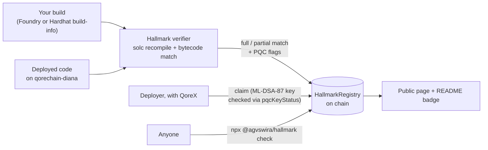

<div align="center">


# Hallmark

**Proof that the contract on QoreChain is the code in your repo.**

Source verification and a post-quantum report for contracts on `qorechain-diana`.

[](https://build.qorechain.io/p/hallmark)
[](https://hallmark-jade.vercel.app/c/0xa901ee7138266abc456c8d717fa94b043078b8c4)
[](https://www.npmjs.com/package/@agvswira/hallmark)
[](LICENSE)

[**Live app**](https://hallmark-jade.vercel.app) · [**Demo video**](https://youtu.be/bQ6GsjzvASY) · [**Try it with QoreX**](https://hallmark-jade.vercel.app/try) · [**5-Min Judge Walkthrough**](JUDGES.md) · [CLI](packages/cli/README.md) · [CBOM](docs/cbom.json) · [How the AI was used](AI_USAGE.md)

Built for [Build Before Q-Day](https://build.qorechain.io), Quantum Pass category.

</div>

> [!NOTE]
> The second badge above is Hallmark's own: the registry contract, verified by Hallmark and recorded in itself.

## Why

QoreChain's explorer has no source verification and no Etherscan-compatible API. Nobody can prove
that a contract deployed on diana was built from the code in a GitHub repository, and the Solidity PQC
features (`pqcVerify`, `pqcKeyStatus`) are checked by reading repositories by hand.

Hallmark makes that check automatic, public and reproducible:

- **Match.** Recompiles your build with the official solc release at the exact version and settings,
  and compares it with the bytecode on chain.
- **Record.** Writes the result to `HallmarkRegistry` on diana. The registry reads the contract's code
  hash itself, so a record can only describe code that is really deployed.
- **Report.** Shows whether the deployed code calls `pqcVerify` (0x…0a01) or `pqcKeyStatus` (0x…0a02),
  and from which functions.
- **Claim.** The deployer links the contract to a repository with QoreX. The registry accepts the
  claim only from an account with a registered ML-DSA-87 key, checked on chain through `pqcKeyStatus`.
- **Recheck.** Anyone can rerun a verification on their own machine with one command, so nobody has to
  trust the Hallmark server.

## How it works



**Full match:** the bytecode and the metadata hash match, which proves the exact sources, settings and
compiler. **Partial match:** the executable code matches but the metadata differs, so the sources,
settings and compiler version are not proven; the page says so. A full record is never replaced by a
partial one, and a record shows when the code at the address changes.

## Quick start

**Try it in a minute, with your QoreX wallet.** Open the [Try it](https://hallmark-jade.vercel.app/try)
page: deploy a small PQ-guarded sample, verify it, and claim it. Every step is a real transaction on diana.

**Verify your own contract.** Build with build-info, deploy, then upload the build-info with the address
and deployment transaction on the [Verify](https://hallmark-jade.vercel.app/verify) page:

```sh
forge build --build-info          # writes out/build-info/*.json
```

Or submit it from the terminal:

```sh
npx @agvswira/hallmark verify --address 0x… --tx 0x… --build-info out/build-info/<file>.json
```

**Check any record yourself.** Node 20 or later, no install:

```sh
npx @agvswira/hallmark check 0xa901ee7138266abc456c8d717fa94b043078b8c4
```

It downloads the matching solc release (checked by SHA-256), recompiles on your machine and compares
six facts with the on-chain record. Exit code 0 means confirmed. See the [CLI README](packages/cli/README.md).

**Add the badge to your README.** Every record page gives you the Markdown:

```md
[](https://hallmark-jade.vercel.app/c/0xYOUR_CONTRACT)
```

## Trust and security

- **The verdict is reproducible.** The server compares; the [CLI](packages/cli/README.md) lets anyone
  rerun the comparison locally against the same on-chain record.
- **The registry trusts one verifier account** to record results. That account can only spend through
  EVM windows scoped to `HallmarkRegistry` (`allowedTargets`), so a leaked server key could not move its
  funds through the EVM; a transfer outside the scope was refused on diana.
- **Red-teamed.** An AI red-team run tried 14 attacks: edited sources, missing metadata, another compiler,
  fake PQC verifiers, non-call / jump-target PQC constants, proxies, stored-source poisoning, link and terminal injection, gas drain. The gaps
  it found are fixed with regression tests. See [docs/ai/redteam.md](docs/ai/redteam.md).
- **Proxies are flagged.** An upgradeable proxy's hallmark covers the proxy, not the code it delegates
  to; the page, the badge and the CLI say so and show the live implementation.
- **No model in the verification path.** Results are deterministic.

Testnet only. See [Limits](AI_USAGE.md#limits) for what is not covered.

## Live on qorechain-diana

| | |
|---|---|
| `HallmarkRegistry` | [`0xa901ee7138266abc456c8d717fa94b043078b8c4`](https://explore.qore.network/address/0xa901ee7138266abc456c8d717fa94b043078b8c4), deployed in `0x16edaac4…92e7` (block 10446802) |
| First hallmark: the registry itself | Full match, `pqcKeyStatus`; [record page](https://hallmark-jade.vercel.app/c/0xa901ee7138266abc456c8d717fa94b043078b8c4) |
| First claim with a real QoreX wallet | [`QuantumGuestbook` sample](https://hallmark-jade.vercel.app/c/0xf5340e357e16da6b9ded7ad9c86148df2ec5f992): deploy `0xbeed8439…a970`, record `0xd944c3ea…1c6e`, claim `0x2ff0b2be…65aa` |
| Ecosystem records (6 total on chain) | All 4 [`Attenua`](https://github.com/agvswira/attenua) contracts (also built by the owner) are full-matched and ML-DSA-87 claimed, including [`AttenuaVault`](https://hallmark-jade.vercel.app/c/0xf585fc6e1e43446f353830e0d11ff44ce747af58) (`pqcVerify` + `pqcKeyStatus`) |
| Verifier account (server) | `qor1vjvnfsgzyhw768g45k0yxgsmzanmsxkjgw8yjl` (`0x649934C10225DDeD1d15a59e43221b1767b81ad2`) |
| Owner (can replace the verifier) | `0xdd8874f79Ec76375B463FAF4AA49f37474173325`, the project owner's QoreX account. It is a coin-118 account, which cannot send EVM transactions directly, so the owner functions are unreachable from QoreX for now ([Limits](AI_USAGE.md#limits)) |
| Network | `qorechain-diana`, EVM chain id 9800 · RPC `https://evm-testnet.qore.host` · REST `https://api-testnet.qore.host` |

## Repository

| Path | What |
|---|---|
| [`JUDGES.md`](JUDGES.md) | 5-minute keyless judge walkthrough |
| [`contracts/`](contracts) | `HallmarkRegistry` and the `QuantumGuestbook` sample, with Foundry unit, fuzz, and invariant tests |
| [`packages/verifier/`](packages/verifier/README.md) | The verification engine: recompile, match, PQC report, proxy detection, recording |
| [`packages/cli/`](packages/cli/README.md) | `@agvswira/hallmark` on npm: `status`, `check`, `verify` |
| [`web/`](web/README.md) | The web app and API (Vite + React on Vercel): verify, registry, record pages, claim, badge, Try it |
| [`docs/cbom.json`](docs/cbom.json) | CycloneDX 1.6 cryptographic inventory (`npm run cbom` via `@qorechain/qorescan`) |
| [`docs/ai/`](docs/ai) | The log, ledger, red-team report and reviews behind [AI_USAGE.md](AI_USAGE.md) |
| [`scripts/`](scripts) | Repository tooling (`verify-submission.mjs` and the pre-commit secret scan) |

## Development

Each block starts from the repository root.

```sh
# Keyless end-to-end audit (live diana chain, API, CLI recompile, CBOM, AI-Native artifacts)
npm install && npm run verify

# Full contract, verifier, CLI, and web test/build suite
npm run test:all
```

```sh
# Contracts: 43 Foundry tests (6 sample + 32 unit/fuzz + 5 stateful invariants × 8,192 calls).
# forge comes from the @foundry-rs/forge npm package, so no global Foundry install is needed.
cd contracts
npm install && npm run forge-std && npm test
```

```sh
# Verifier: 61 tests across 7 files, including end-to-end and red-team tests on a local anvil chain.
cd packages/verifier
npm install && npm test && npm run build
```

```sh
# Web app with the API routes, on http://localhost:5173 (build the verifier first).
cd web
npm install && npm run dev
```

Recording on chain is off locally unless `HALLMARK_VERIFIER_MNEMONIC` and `HALLMARK_PUBLIC_URL` are set
(see [web/README.md](web/README.md)); verification and the pages work without them.

Working rules for AI agents and contributors are in [CLAUDE.md](CLAUDE.md): commits under the owner's
name, secrets only in gitignored `.env` files, testnet only, and a secret scan on every commit.

## Credits

- Scaffolded with [`create-qorechain-dapp`](https://www.npmjs.com/package/create-qorechain-dapp) 0.14
  (`foundry` and `viem-wagmi` templates), including the template's `scripts/window.ts` EVM window helper.
- [`@qorechain/sdk`](https://www.npmjs.com/package/@qorechain/sdk),
  [`@qorechain/evm`](https://www.npmjs.com/package/@qorechain/evm),
  [`@qorechain/qorex-rainbowkit`](https://www.npmjs.com/package/@qorechain/qorex-rainbowkit),
  [`@qorechain/qorescan`](https://www.npmjs.com/package/@qorechain/qorescan).
- [`@ethereum-sourcify/lib-sourcify`](https://github.com/argotorg/sourcify) (MIT) for bytecode matching, and
  [solc-js](https://github.com/ethereum/solc-js) (MIT) with the official soljson builds.
- [Manrope](https://github.com/sharanda/manrope) (SIL Open Font License) via [Fontsource](https://fontsource.org), self-hosted.
- [forge-std](https://github.com/foundry-rs/forge-std) (MIT/Apache-2.0) and
  [Foundry](https://github.com/foundry-rs/foundry) via `@foundry-rs/forge`.

## AI use

Built with an AI coding agent. The workflow, what the AI generated and what the owner decided are
documented in [AI_USAGE.md](AI_USAGE.md) from the first commit, with a dated [log](docs/ai/log.md), a
per-change [ledger](docs/ai/ledger.jsonl), the [red-team report](docs/ai/redteam.md) and
[review reports](docs/ai/reviews).

## Feedback

Questions, bugs or a contract that does not verify: [open an issue](https://github.com/agvswira/hallmark/issues)
with the contract address and, if you have it, the deployment transaction.

## License

[MIT](LICENSE) © 2026 Komang Agus Wira Adnyana
